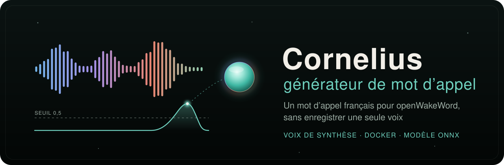
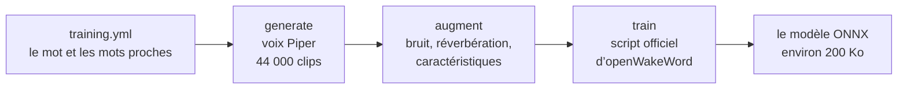

<div align="center">



<h3>Votre mot d’appel en français, entraîné sur votre machine, à partir de voix de synthèse.</h3>

<p>
  
  
  <a href="https://github.com/dscripka/openWakeWord"></a>
  
  
  <a href="LICENSE"></a>
</p>

<p>
  <a href="#-démarrer">Démarrer</a> ·
  <a href="#-ce-quil-fait">Ce qu’il fait</a> ·
  <a href="#-comment-ça-marche">Comment ça marche</a> ·
  <a href="#-avec-cornelius">Avec Cornelius</a> ·
  <a href="docs/README.md">Documentation</a> ·
  <a href="#-licence">Licence</a>
</p>

</div>

---

openWakeWord, le logiciel libre qui écoute un mot d’appel, ne livre que des modèles en anglais. Ce générateur fabrique un modèle pour **un mot français de votre choix** : il le fait dire des dizaines de milliers de fois par des voix de synthèse, avec les mots qui lui ressemblent, puis entraîne le modèle avec le script officiel d’openWakeWord. Un testeur au micro permet ensuite de l’essayer et de choisir son seuil.

Il a été écrit pour le mot « Cornelius » du miroir [Cornelius](https://github.com/lfpoulain/Cornelius), qui embarque le modèle obtenu. Sa configuration, `training.yml`, vise toujours ce mot : quelques lignes à changer suffisent pour en entraîner un autre.

Tout se passe sur votre ordinateur. Aucune voix réelle n’est enregistrée, ni pour l’entraînement, ni pendant les essais.

## 🧰 Ce qu’il faut

| | |
|---|---|
| 🐳 **Pour entraîner** | Docker avec des conteneurs Linux (Docker Desktop sous Windows), et environ **40 Go** libres |
| ⚡ **Pour aller vite** | un GPU NVIDIA accessible à Docker ; sans lui, l’entraînement passe par le processeur, en plus lent |
| 🎙️ **Pour essayer** | Python 3.12 avec Tkinter, et un micro |
| 📶 **Une fois** | une connexion pour télécharger les voix et les données (18 Go), gardées pour les mots suivants |

Le détail, pas à pas, est dans [Préparer la machine](docs/installer.md).

## 🚀 Démarrer

**1. Récupérer le dépôt**

```sh
git clone https://github.com/lfpoulain/wakeword-generator.git
cd wakeword-generator
```

**2. Décrire le mot**, dans `training.yml` :

```yaml
model_name: barnabe          # le nom du fichier produit : output/barnabe.onnx
target_phrase:               # les façons d’écrire le mot pour que les voix le disent bien
  - "Barnabé"
  - "Barna bé"
custom_negative_phrases:     # les mots proches qui ne doivent pas le déclencher
  - "Barbara"
  - "Barnum"
  - "Bernadette"
```

Pour reconstruire le modèle « Cornelius », ne changez rien.

**3. Entraîner**

| Windows (PowerShell) | Linux |
|---|---|
| `.\build.ps1` | `./build.sh` |
| sans GPU : `.\build.ps1 -Cpu` | sans GPU : `./build.sh --cpu` |

Le script construit l’image Docker, télécharge les données, génère les clips, puis entraîne. Le premier entraînement est long : laissez-le tourner. Interrompu, il se relance sans refaire ce qui est fini. Le modèle arrive dans **`output/<model_name>.onnx`**.

**4. Essayer au micro**, après avoir [installé le testeur](docs/tester.md#installer-le-testeur) :

| Windows | Linux |
|---|---|
| double-clic sur `tester.bat` | `./tester.sh` |

Dites le mot : il passe au vert à chaque détection.

> [!TIP]
> Pour un mot jamais essayé, écoutez les premiers clips générés avant d’attendre la fin : voir [Écouter les premiers clips](docs/entrainer.md#écouter-les-premiers-clips).

## ✨ Ce qu’il fait

<table>
  <tr>
    <td width="50%" valign="top">
      <h4>🗣️ Il fait parler des voix françaises</h4>
      Quatre locuteurs Piper (Siwis, Jessica, Pierre et Tom), cinq débits et intonations, chaque graphie du mot à parts égales : 22 000 clips du mot, autant de mots proches.
    </td>
    <td width="50%" valign="top">
      <h4>🎯 Il apprend ce qui n’est pas le mot</h4>
      Les mots qui lui ressemblent, que vous choisissez, et 2 000 heures de sons et de paroles fournies par openWakeWord.
    </td>
  </tr>
  <tr>
    <td valign="top">
      <h4>🏠 Il imite une vraie pièce</h4>
      Chaque clip est abîmé à dessein : bruits de fond AudioSet, réverbération de 270 lieux réels, égaliseur, hauteur de voix.
    </td>
    <td valign="top">
      <h4>🔁 Il reprend où il s’était arrêté</h4>
      Téléchargements, clips et caractéristiques déjà faits sont gardés. Une étape se relance seule : <code>.\build.ps1 generate</code>, <code>doctor</code> pour faire le point.
    </td>
  </tr>
  <tr>
    <td valign="top">
      <h4>🛡️ Il ne mélange rien</h4>
      Il refuse de mêler deux recettes sous un même nom, ne remplace jamais un modèle existant et vérifie l’empreinte des voix et des données téléchargées.
    </td>
    <td valign="top">
      <h4>🎙️ Il s’essaie au micro</h4>
      Une petite fenêtre affiche le score en direct, compte les détections et aide à choisir le seuil. Le son n’est jamais enregistré.
    </td>
  </tr>
</table>

## 🔬 Comment ça marche



| Étape | Ce qui se passe | Sur |
|---|---|---|
| `prepare` | télécharge les voix, les sons de fond, les pièces et les 2 000 heures de négatifs | le réseau, une seule fois |
| `generate` | fait dire le mot et les mots proches aux voix françaises | le processeur, en parallèle |
| `augment` | abîme les clips comme un vrai micro, puis en calcule les caractéristiques | le processeur |
| `train` | entraîne le petit classifieur d’openWakeWord et l’exporte en ONNX (environ 200 Ko) | le GPU, ou le processeur |

Tout tourne dans une image Docker aux versions figées (CUDA 11.7, PyTorch 1.13, openWakeWord à un commit précis). Le détail est dans [Comment ça marche](docs/fonctionnement.md).

## 🪞 Avec Cornelius

Cornelius cherche son modèle dans `models/cornelius.onnx`. Copiez-y le vôtre, ou indiquez son chemin dans son `.env`, puis relancez Cornelius :

```powershell
Copy-Item output\cornelius.onnx ..\cornelius\models\cornelius.onnx
```

```ini
CORNELIUS_WAKE_MODEL=/chemin/vers/wakeword-generator/output/barnabe.onnx
CORNELIUS_WAKE_THRESHOLD=0.5
```

Les satellites audio de Cornelius envoient leur son à l’ordinateur, qui y cherche le mot avec ce même modèle : un seul fichier à changer pour toute la maison. Tout autre programme qui utilise openWakeWord en ONNX peut aussi le charger. Voir [Utiliser le modèle](docs/utiliser.md).

## 📚 Documentation

| | |
|---|---|
| **Démarrer** | [Préparer la machine](docs/installer.md) · [Entraîner un mot](docs/entrainer.md) |
| **Essayer** | [Tester au micro](docs/tester.md) : juger le modèle, choisir le seuil |
| **Utiliser** | [Utiliser le modèle](docs/utiliser.md) : Cornelius, un autre programme, le partager |
| **Comprendre** | [Comment ça marche](docs/fonctionnement.md) · [Les réglages de `training.yml`](docs/reglages.md) |
| **En cas de souci** | [Dépannage](docs/depannage.md) |
| **Suivre** | [Historique des changements](CHANGELOG.md) · [Contribuer](CONTRIBUTING.md) |

## 🔒 Confidentialité

- 🏠 L’entraînement se fait entièrement sur votre ordinateur. Seuls les téléchargements passent par Internet.
- 🗣️ Aucune voix réelle n’entre dans le corpus : tous les exemples du mot sont des voix de synthèse.
- 🎙️ Le testeur analyse le micro à la volée, sans rien enregistrer ni envoyer.

## 📜 Licence

Le code de ce dépôt est distribué, comme Cornelius, sous la [PolyForm Noncommercial License 1.0.0](LICENSE) : utilisation, partage et modification libres pour un usage non commercial, en gardant la ligne `Required Notice` du fichier `LICENSE`.

Le dépôt ne contient aucun poids, aucune voix ni aucun corpus : ils sont téléchargés sur votre machine, chacun avec sa licence, et ces licences s’appliquent aux modèles que vous entraînez. Un modèle produit se diffuse sous **CC BY-NC-SA 4.0**, pour un usage non commercial, avec ses attributions : voir [Partager le modèle](docs/utiliser.md#partager-le-modèle) et [THIRD_PARTY_NOTICES.md](THIRD_PARTY_NOTICES.md).
