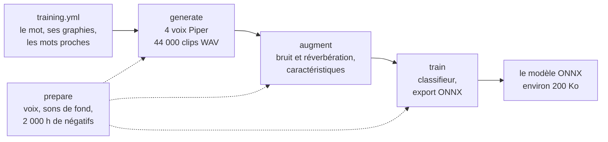

# Comment ça marche

Cette page explique ce que fait le générateur, étape par étape, et pourquoi. Elle s’adresse à qui veut comprendre un résultat, changer la recette ou contribuer. Pour simplement entraîner un mot, [Entraîner un mot](entrainer.md) suffit.

## Vue d’ensemble

openWakeWord ne livre que des modèles en anglais. Pour obtenir un mot français sans enregistrer personne, le générateur le fait dire à des voix françaises de synthèse, avec des mots proches à ne pas confondre, puis confie le reste au script d’entraînement officiel d’openWakeWord.



Tout tourne dans l’image Docker `wakeword-fr-training`, sur le dossier du dépôt monté dans `/workspace`. `pipeline.py` enchaîne les étapes ; `download_assets.py` fait les téléchargements.

## Ce que le modèle apprend

Un modèle openWakeWord ne travaille pas sur le son brut. Deux modèles communs à tous les mots, les modèles de prétraitement, transforment d’abord le son en spectrogramme, puis en une suite de 96 nombres toutes les 80 ms. Le modèle du mot lit les derniers de ces vecteurs, soit environ deux secondes de son, et rend un score entre 0 et 1.

C’est pourquoi le modèle produit est si petit (environ 200 Ko), et pourquoi il a besoin de ces deux modèles de prétraitement pour fonctionner.

## 1. `prepare` : les téléchargements

| Source | Contenu | Vérification |
|---|---|---|
| Voix Piper v1.0.0, Hugging Face | trois voix `fr_FR` *medium*, leur configuration et leur fiche | empreinte SHA-256, voix espeak française |
| Réponses de pièces du MIT | 270 WAV à 16 kHz | nombre et taille des fichiers |
| AudioSet, un fragment figé à une révision | 500 clips convertis en WAV mono à 16 kHz | taille et empreinte SHA-256 du fragment |
| Caractéristiques d’openWakeWord | 2 000 heures de négatifs (ACAV100M) et les données de validation | taille minimale |

Les téléchargements passent par un fichier `.part`, renommé seulement une fois complet, et reprennent là où ils s’étaient arrêtés.

## 2. `generate` : les clips de synthèse

### Les voix

| Voix | Locuteurs | Fréquence d’origine |
|---|---|---|
| `fr_FR-siwis-medium` | Siwis | 22 050 Hz |
| `fr_FR-upmc-medium` | Jessica, Pierre | 22 050 Hz |
| `fr_FR-tom-medium` | Tom | 44 100 Hz |

Chaque clip est ramené en mono, 16 bits, 16 kHz, le format qu’attend openWakeWord.

### Les variations

Piper reçoit cinq jeux de réglages, du plus rapide au plus lent, qui font aussi varier l’intonation et le rythme :

| Débit (`length_scale`) | Variation du timbre (`noise_scale`) | Variation du rythme (`noise_w`) |
|---|---|---|
| 0,78 | 0,52 | 0,6 |
| 0,9 | 0,667 | 0,8 |
| 1,0 | 0,8 | 0,9 |
| 1,12 | 0,667 | 1,0 |
| 1,28 | 0,9 | 0,7 |

### La répartition

Les clips sont distribués à tour de rôle :

- chaque locuteur reçoit le même nombre de clips, à un près ;
- chaque locuteur dit chaque graphie et chaque variation autant de fois, à un près ;
- les mots proches suivent la même règle.

Ces trois propriétés sont vérifiées par les tests (`tests/test_distribution.py`).

Pour une voix d’au moins 20 locuteurs, le dernier cinquième serait réservé à la validation. Les voix utilisées en ont un ou deux : les mêmes locuteurs servent à l’entraînement et à la validation.

### La durée des clips

- Un clip du mot doit durer au moins 0,55 s, un mot proche au moins 0,2 s. Trop court, il est refait jusqu’à six fois avec une voix plus lente, puis avec un autre locuteur de la même voix.
- Un clip du mot de plus de 1,75 s est accéléré (`ffmpeg`, filtre `atempo`), pour tenir en entier dans la fenêtre de deux secondes d’openWakeWord.

### La provenance

Au premier lancement, `generation.json`, dans le dossier de travail, retient la recette : sa version, les graphies, les mots proches, et chaque voix (nom et taille du fichier). Si l’un d’eux change ensuite sous le même `model_name`, le générateur refuse de continuer plutôt que de mélanger deux corpus.

Chaque clip est écrit sous un nom provisoire, puis renommé une fois complet : un arrêt brutal ne laisse jamais de clip à moitié écrit.

## 3. `augment` : bruit, réverbération, caractéristiques

C’est le script officiel d’openWakeWord (`train.py --augment_clips`) qui s’en charge :

1. chaque clip est placé vers la fin d’une fenêtre d’environ deux secondes ;
2. il subit des altérations tirées au hasard, chacune avec une certaine probabilité : égaliseur, légère distorsion, hauteur décalée de trois demi-tons au plus, filtre coupe-bande, bruit coloré, son de fond AudioSet parfois plus fort que la voix, volume, réverbération d’une pièce du MIT ;
3. ses caractéristiques sont calculées par les modèles de prétraitement.

Il en sort quatre fichiers dans le dossier de travail : `positive_features_train.npy`, `negative_features_train.npy`, `positive_features_test.npy`, `negative_features_test.npy`. Le générateur force cette étape sur le processeur : sur GPU, le modèle d’embedding donne des valeurs différentes de celles du processeur, celui qui calcule les caractéristiques à l’usage, et PyTorch 1.13 en CUDA 11.7 ne sait pas faire de FFT sur les RTX 40.

### Le dossier de travail

Clips et caractéristiques (quelques Go par mot) vivent dans le volume Docker `wakeword-travail`, sous `/travail/<model_name>/`, et non dans `output/` : ouvrir un fichier à travers le dossier partagé entre Windows et Docker coûte environ 10 ms, soit un tiers du temps de génération et d’augmentation. Sans la variable `WAKEWORD_WORK` (commandes Docker lancées à la main), tout reste dans `output/<model_name>/`. L’étape `ecoute` copie quelques clips dans `output/<model_name>-ecoute/`.

Si ces quatre fichiers sont déjà complets, l’étape est sautée.

## 4. `train` : l’entraînement

Toujours avec le script officiel (`train.py --train_model`). Chaque lot mêle trois sources : les caractéristiques négatives générales (2 000 heures), les mots proches et le mot. L’entraînement compte trois phases :

1. `steps` pas, pendant lesquels le poids des négatifs monte jusqu’à `max_negative_weight` ;
2. puis deux affinages de `steps / 10` pas, à un taux d’apprentissage dix puis cent fois plus faible, avec un poids des négatifs doublé à chaque fois.

Pendant le dernier quart de la première phase, puis tout au long des affinages, le modèle est mesuré vingt fois par phase : taux de reconnaissance du mot sur les clips de validation, et faux déclenchements par heure sur environ 11 heures de sons. Les meilleurs états sont moyennés en un seul modèle, exporté en ONNX dans `output/<model_name>.onnx`.

Le terminal affiche une barre de progression « Training » par phase.

## Les retouches au script officiel

Le `Dockerfile` installe openWakeWord à un commit précis et y applique deux retouches :

- `default="False"` devient `default=False` dans les options du script : sans cela, une option non demandée valait la chaîne `"False"`, que Python considère comme vraie ;
- la validation des faux déclenchements se fait par lots de 2 048, au lieu d’un seul lot qui contenait toute la validation, pour tenir en mémoire.

## Les commandes de `pipeline.py`

`build.ps1` et `build.sh` lancent `pipeline.py` dans Docker. Chaque commande se passe en premier argument du script :

| Commande | Effet |
|---|---|
| `build` | tout, dans l’ordre ; refuse si le modèle existe déjà (par défaut) |
| `doctor` | fait le point, sans rien modifier |
| `prepare` | les téléchargements |
| `generate` | les clips manquants |
| `augment` | l’augmentation ; le script officiel la saute si ses fichiers existent |
| `train` | l’entraînement et l’export ; refuse si le modèle existe déjà |

```powershell
.\build.ps1 doctor
.\build.ps1 train -Cpu
```

```sh
./build.sh doctor
./build.sh train --cpu
```

Seules `build` et `train` demandent le GPU. La génération reste sur le processeur, en parallèle : pour des phrases de deux mots, Piper y est quatre fois plus rapide que sur le GPU. Les commandes équivalentes, sans les scripts (ajouter `-v wakeword-travail:/travail -e WAKEWORD_WORK=/travail` pour le dossier de travail) :

```sh
docker build -t wakeword-fr-training .
docker run --rm --gpus all --shm-size=8g -v "$(pwd):/workspace" -w /workspace wakeword-fr-training --config training.yml build
```

`--config` choisit un autre fichier de réglages : utile pour garder un fichier par mot.

## L’organisation du dépôt

| Fichier | Rôle |
|---|---|
| `training.yml` | le mot visé, les mots proches et les réglages de l’entraînement |
| `pipeline.py` | génération des clips, contrôles, appel du script officiel (dans Docker) |
| `download_assets.py` | téléchargement et vérification des voix et des données |
| `Dockerfile` | l’environnement d’entraînement, aux versions figées |
| `build.ps1`, `build.sh` | construction de l’image et lancement d’une étape |
| `tester.py`, `tester.bat`, `tester.sh` | le testeur au micro |
| `tester-requirements.txt` | les composants Python du testeur |
| `tests/` | tests de la répartition des voix et des graphies |

## Voir aussi

- [Les réglages de `training.yml`](reglages.md)
- [openWakeWord : entraîner un nouveau modèle](https://github.com/dscripka/openWakeWord#training-new-models)
- [Piper](https://github.com/OHF-Voice/piper1-gpl) et ses [voix](https://huggingface.co/rhasspy/piper-voices)
